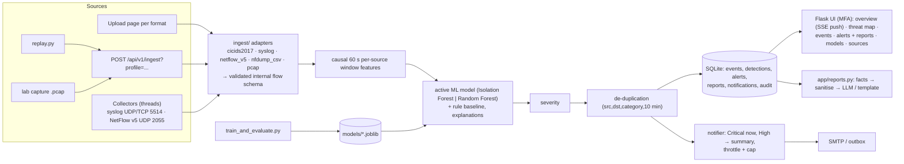

# AI-Driven Network Threat Detection and Visualisation

This is NIT3003 Capstone Project 2 (Cybersecurity / Data Science): a security dashboard for small businesses. It ingests network logs, detects anomalies and intrusions with machine learning, and visualises threats. It covers the **minimum viable scope plus the stretch scope**, including optional SMS alerts through Twilio (FR-10).

## Requirements coverage

Use cases UC-01 … UC-11 from the final report (v5) are mapped, with priority and status, in `docs/design/REQUIREMENTS_MAPPING.md`.
Pages added for them: **Incidents** (timeline, status, notes, merge, editable report versions - UC-04 A3-A7, UC-10), **Simulator**
(in-app replay at 1x/10x/100x with attack filter, pause/stop and run summary - UC-02), **invitation-based accounts** (UC-07, UC-01 A3),
lab-capture datasets, dashboard custom range / saved layout / model panel / incident timeline (UC-03), sensitivity presets with
preview and model rollback (UC-06), clearer upload errors and an interval `.pcap` capture folder (UC-08), and SMS alerts through Twilio (FR-10, UC-05 A2, UC-09 A4 - see §6a).

| # | Brief requirement | Status | Where / how |
|---|---|---|---|
| 1 | Secure administrator portal with MFA and an audit trail | ✅ | Argon2id password → 2-minute MFA challenge → TOTP (QR enrolment; SVG QR if Pillow is missing). Also: lockout, per-IP throttle, 30-minute idle timeout, CSRF, strict CSP, append-only audit log with CSV export (`app/auth.py`, `app/security.py`). |
| 2 | Ingestion pipeline for Syslog, firewall logs, NetFlow or .pcap | ✅ all four | Pluggable adapters in `ingest/`: `cicids2017` (CSV), `syslog` (RFC 3164/5424, iptables/UFW firewall lines), `netflow_v5` (binary datagrams), `nfdump_csv`, and `pcap` (.pcap/.pcapng → bidirectional flows). There is an upload page per format, an API (`?profile=`) and live UDP/TCP collectors. |
| 3 | Anomaly detection model distinguishing normal from malicious | ✅ | Isolation Forest (unsupervised), Random Forest (supervised) and a transparent rule baseline. The admin chooses the active model. |
| 4 | Near-real-time dashboard with network health, flagged activity and a **geo-map** | ✅ | Overview charts with Server-Sent-Events push (polling fallback); flagged events; alerts; a Leaflet threat map of sources and destinations (offline DB-IP database, internal addresses at the site location). |
| 5 | Alerting by email and SMS for critical threats, with severity levels | ✅ email and SMS | Four severity levels. Critical alerts are emailed immediately; High alerts go into a periodic summary. SMTP is used if configured, otherwise a dev outbox. Critical alerts (configurable: High) also send a short SMS through the Twilio REST API, or to `instance/sms_outbox/` when Twilio is not configured (§6a). |
| 6 | AI-assisted incident reports in plain English | ✅ | "Generate report" on every alert. Any OpenAI-compatible LLM receives structured, sanitised facts only. Without a key, a deterministic template is used. Reports are versioned, stored and audited (`app/reports.py`). |
| 7 | Alert de-duplication and throttling | ✅ | Grouping on (source, destination, category) within 10 minutes; one email per alert per 30 minutes unless severity rises; at most 20 emails per hour, with overflow into the summary. |
| 8 | Reproducible attack simulation in an isolated lab | ✅ | `lab/`: Docker Compose on an `internal: true` network (nginx+ssh target, nmap/hping3 attacker, tcpdump capture). **The Docker lab actually ran on the build box** (nmap -sT + hping3 -S, §7). There is also a no-Docker fallback using a network namespace, which ran as well. |

| AI-assisted capability (brief) | Status | Where |
|---|---|---|
| Public labelled dataset + lab capture; split explained, no leakage | ✅ | CIC-IDS2017, split by whole capture day (§4). The lab capture is used as an extra live test (§7). |
| Compare ≥ 2 approaches (unsupervised + supervised); P/R/F1, FP per hour, detection delay, confusion matrix | ✅ | §5. `reports/metrics.json`, confusion matrices and PR comparison plots, plus the Models page. |
| Explainability (SHAP / feature importance per alert) | ✅ | Random Forest: SHAP `TreeExplainer` (or the exact Saabas path decomposition if `shap` is not installed), with the method labelled. Isolation Forest: robust z-score feature deviation. Global importance is on the Models page. |
| LLM reports: facts only, required sections, unverified claims marked, prompt-injection defence | ✅ | §6 |
| Threshold tuning: sensitivity control showing the precision-recall effect | ✅ | Models page: one 0–1 slider for both models, with sweep tables and plots for each |
| Risk focus: IP handling, adversarial evasion, legal/ethical testing limits | ✅ | §9 and `lab/LAB_SAFETY.md`. IP display modes are full, truncate or hash. |

---

## 1. Quick start on Windows (PowerShell, Python 3.13–3.15, no venv activation needed)

Packages are installed into your user site-packages. `flask` does not need to be on PATH, because every command uses `python -m ...`.

```powershell
cd threat-detection
python -m pip install --user -r requirements.txt
# optional extras - install the ones that have wheels for your Python (fallbacks exist for all of them)
python -m pip install --user --only-binary=:all: shap maxminddb matplotlib pyarrow pillow
copy .env.example .env          # then edit SECRET_KEY, TOTP_ENC_KEY, INGEST_API_KEY

python scripts\download_dataset.py        # CIC-IDS2017 CSVs (~284 MB zip, only needed to retrain / replay)
python scripts\download_geoip.py          # DB-IP City Lite (~130 MB, CC BY 4.0) for the threat map
python scripts\train_and_evaluate.py      # retrain + evaluate all detectors (~2 min, ~4 GB RAM)
python -m flask --app wsgi.py create-admin --email admin@example.com
python -m flask --app wsgi.py run         # http://127.0.0.1:5000  (MFA QR enrolment at first sign-in)
python -m pytest -q                       # 64 tests
```

There are two helper scripts:
- `powershell -ExecutionPolicy Bypass -File .\run_windows.ps1 setup`. Other commands: `install`, `data`, `train`, `admin`, `run` (with collectors), `collector`, `demo`, `replay`, `test`, `lab`.
- `setup.bat` does the same one-shot setup from cmd.exe.

**Streaming (live) ingestion.** Use either of these:
- Set `ENABLE_COLLECTORS=1` before `python -m flask --app wsgi.py run`.
- Run `python scripts\collector.py` in a second terminal.

The collectors listen on `127.0.0.1` for syslog (UDP and TCP 5514) and NetFlow v5 (UDP 2055). Events are scored in batches about once a second, and open dashboards update by server push. Demo senders:

```powershell
python scripts\send_syslog.py --demo            # benign UFW lines + a 1,000-port scan, timestamped now
python scripts\send_syslog.py --file C:\logs\ufw.log --tcp
python scripts\send_netflow.py                  # benign flows + a SYN flood
python scripts\replay.py --speed 60             # replay held-out CIC-IDS2017 Friday traffic (needs the dataset)
```

**Uploads:** go to Data sources → pick a format (`cicids2017`, `syslog`, `netflow_v5`, `nfdump_csv`, `pcap`). Sample files are in `tests/fixtures/`. The API equivalent is:

```powershell
curl.exe -X POST -H "X-API-Key: <INGEST_API_KEY>" --data-binary "@lab\captures\netns_lab.pcap" "http://127.0.0.1:5000/api/v1/ingest?profile=pcap&filename=lab.pcap"
```

**Email in development.** If `SMTP_HOST` is empty, `.eml` files go to `instance/outbox/`. To use a local test SMTP server: run `python -m pip install --user -r requirements-dev.txt`, then `python -m aiosmtpd -n -l 127.0.0.1:8025`, then set `$env:SMTP_HOST="127.0.0.1"; $env:SMTP_PORT="8025"; $env:SMTP_STARTTLS="false"`.

**LLM reports.**
- Leave `LLM_API_KEY` empty to get template reports.
- For any OpenAI-compatible endpoint, set `LLM_API_BASE`, `LLM_API_KEY` and `LLM_MODEL`.
- **Free, local, no account:** use [Ollama](https://ollama.com) (`ollama pull llama3.2`) with `LLM_API_BASE=http://127.0.0.1:11434/v1`, `LLM_API_KEY=ollama` and `LLM_MODEL=llama3.2`. Another option is `llama-cpp-python[server]` with a small GGUF model; that is what was verified here (§6).

Linux and macOS use the same commands with `/` paths (`python3 -m flask --app wsgi.py run`).

The trained models (`models/*.joblib`, about 5 MB) and evaluation outputs (`reports/`) are included, so the dataset is only needed to retrain or replay. If your scikit-learn version differs from the one used for training (1.9.1) and you see a version warning, run `python scripts\train_and_evaluate.py` again.

### Dependencies and fallbacks

| Package | Needed for | If missing |
|---|---|---|
| `dpkt` (pure Python) | .pcap/.pcapng parsing | required (in requirements.txt) |
| `shap` | SHAP TreeExplainer | exact in-house Saabas/TreeInterpreter path contributions (labelled as such; `EXPLAINER=saabas` forces it) |
| `maxminddb` | GeoIP lookups | built-in pure-Python MMDB reader (`app/geo.py`) |
| `matplotlib` | PNG plots during training | plots skipped; metrics are still written |
| `pyarrow` | parquet dataset cache | pickle cache |
| `pillow` | PNG QR code | SVG QR code |
| `aiosmtpd`, `playwright`, `pytest` | dev only (`requirements-dev.txt`) | – |

---

## 2. Architecture



```
app/        factory/CLI, auth (MFA), views (dashboard, SSE, map, reports), admin, api, pipeline,
            geo.py (MMDB lookup), privacy.py (IP display modes), reports.py (LLM/template incident reports)
ingest/     schema, adapter registry, cicids2017, syslog, netflow (v5 + nfdump), pcap, flowbuild, collectors, windows
ml/         features, data (split + cache), evaluate, explain (SHAP/Saabas), detectors/{isolation_forest, supervised, rules}
alerts/     severity, notifier, emailer
scripts/    download_dataset, download_geoip, train_and_evaluate, replay, collector, send_syslog, send_netflow, screenshots
lab/        docker-compose.yml, attacker/target/capture images, attack.py, netns_lab.py, ingest_capture.py, LAB_SAFETY.md
tests/      64 pytest tests + fixtures (CIC CSV, syslog, nfdump CSV, NetFlow v5, pcap)
```

Existing databases are upgraded automatically: new columns are added at startup.

---

## 3. Ingestion formats and feature mapping

All adapters produce the same internal flow schema: 5-tuple, timestamp, and 33 CICFlowMeter-style statistics. The model uses 12 of them, plus the causal 60-second window counts. Invalid records are rejected and counted per reason, for example bad IPs, ports outside 0–65535, unreadable timestamps, or negative or non-finite values. These counts are shown on the job list.

| Format | One record = | Exact | Approximated / unavailable |
|---|---|---|---|
| CIC-IDS2017 CSV | CICFlowMeter flow | everything (training format) | – |
| **pcap/pcapng** (dpkt) | bidirectional flow (5-tuple; first packet = forward). Ends on RST, FIN in both directions, or a 120 s timeout. | Duration; fwd/bwd packets and payload bytes; packet-length max/mean/std; rates; IAT mean/std/max; flag counts; initial TCP windows; `act_data_pkt_fwd`; window counts. Byte counts come from IP/TCP/UDP length fields, so small-snaplen captures stay exact. | `active_mean`/`idle_mean` (approximated with a 5 s idle gap). Flow boundaries differ slightly from CICFlowMeter's quirks (as in CICFlowMeter, a packet after FIN/FIN starts a new 1-packet flow). Zero-duration flows get rate 0 instead of Infinity. Bulk and subflow features are not computed (not used by the model). |
| **syslog** (RFC 3164/5424, iptables/UFW) | one logged packet | 5-tuple; protocol; `LEN` as bytes; TCP flags; `WINDOW` → initial window; window counts | Everything per-flow (bwd, IAT, duration = 0) – a firewall log line is one packet. RFC 3164 has no year (the current year is assumed). The message text is stored sanitised and capped at 300 characters, and is shown to admins only. It is never used by the models or the LLM. |
| **NetFlow v5** / **nfdump CSV** | unidirectional flow record | duration, packets, bytes, rates, mean size, window counts; nfdump `opkt/obyt` → bwd | Bytes include L3/L4 headers (CICFlowMeter counts payload). Flags are cumulative (0/1, not counts). IAT, window and active/idle are not available (defaults). |

**Domain-shift warning (real observation).** The models were trained on CICFlowMeter flows. Per-packet syslog events and NetFlow records differ systematically, so the Isolation Forest flags many benign streaming events as anomalous. In the verification run it flagged 308 of 501 (61 %) benign demo syslog and NetFlow events. On those sources, the **rule baseline** (port-variety and flood counts, which only need the 5-tuple and timestamps) is the reliable detector. Retraining on in-format benign data would be the next step.

---
## 4. Dataset and split

* **Dataset:** CIC-IDS2017, *GeneratedLabelledFlows.zip* (folder `TrafficLabelling`), 8 CSV files, 5 capture days (3–7 July 2017), 2.83 M flows with timestamps, IPs, ports, protocol, 80+ CICFlowMeter statistics and a label.
* **Source:** Canadian Institute for Cybersecurity, University of New Brunswick — <https://www.unb.ca/cic/datasets/ids-2017.html>. The UNB download server (`cicresearch.ca`) returned HTTP 500 at build time, so the identical zip was downloaded from the Hugging Face mirror `bencorn/CICIDS2017` (pinned commit `811c007f…`, sha256 `7bdbef28…a27a`, see `scripts/download_dataset.py`).
* **Licence / terms:** UNB states the dataset is publicly available for researchers and that users must cite: *I. Sharafaldin, A. H. Lashkari, A. A. Ghorbani, "Toward Generating a New Intrusion Detection Dataset and Intrusion Traffic Characterization", ICISSP 2018.* The raw data is not redistributed in this zip.
* **Ingestion quality** (from the real run): blank padding rows (288,602 in the Thursday-morning file) and rows with non-finite rates (`Flow Bytes/s` = NaN/Infinity) or invalid negative values are rejected and counted per file (`reports/metrics.json → ingestion`). CIC-IDS2017 writes afternoon times on a 12-hour clock without AM/PM; the capture ran only 08:30–17:10, so hours 1–7 are shifted +12 h (documented in `ingest/validate.py`, unit-tested).

**Split (no leakage across attack sessions).** Whole capture days are assigned to one split, so no attack session is ever split between training and testing (no random row split):

| Split | Days | Flows | Attacks in it | Used for |
|---|---|---|---|---|
| Train | Monday | 529,466 (all benign) | none | fitting the Isolation Forest (benign only) and calibrating rule thresholds |
| Validation | Tuesday + Wednesday | 1,137,013 (265,555 attack) | FTP/SSH-Patator, DoS Hulk/GoldenEye/slowloris/Slowhttptest, Heartbleed | feature-subset choice, decision threshold, risk calibration |
| Test (held out) | Thursday + Friday | 1,161,282 (291,001 attack) | Web attacks (brute force, XSS, SQLi), Infiltration, Bot, PortScan, DDoS | all reported metrics; replay demo |

Test-day attack types never appear in training or validation, so the test numbers measure generalisation to unseen attacks. The test days were not used for any modelling choice.

**Features.** 9 CICFlowMeter statistics (duration, fwd/bwd packets and bytes, packet rate, mean packet length, initial TCP windows) + 3 causal 60-second window counts per source (flows, distinct destination ports, flows to the same destination), signed `log1p`. The window counts are computed in arrival order, so batch evaluation and live replay see identical values. The subset was chosen from 5 candidates on **validation** data only (`reports/feature_selection.json`: val ROC-AUC 0.948 with all 36 candidates vs 0.976 with the chosen 12; 0.890 without the window features).

**Model.** `IsolationForest(n_estimators=200, max_samples=256, random_state=42)` fitted on all 529,466 Monday flows. The decision threshold is the raw-score cut-off with the best F1 on the validation days (raw 0.5854). Raw scores are mapped to a 0–1 **risk scale** by a monotone piecewise-linear calibration (benign validation median → 0.35, chosen threshold → 0.70 = default sensitivity, 99.9th validation percentile → 1.0). It is a ranking scale, not a probability.

**Rule baseline.** R1 port scan: ≥ 731 distinct destination ports from one source within 60 s; R2 DoS/flood: ≥ 891 flows from one source to one destination within 60 s. Both are 1.1 × the maximum seen on benign Monday traffic.

**Severity** (proposal FR-07): Critical = risk ≥ 0.90 or a rule identifies DoS/flood; High = 0.80–0.89; Medium = above the sensitivity threshold; Low = rule-only detection.


**Supervised model (Random Forest).** Settings: `RandomForestClassifier(n_estimators=100, max_depth=14, min_samples_leaf=20, max_features="sqrt", class_weight="balanced_subsample", max_samples=0.25, random_state=42)` on the same 12 features. The split avoids leakage and leaves the test days untouched:

| Role | Data | Attacks |
|---|---|---|
| Train | Monday + Tuesday + Wednesday before 10:40 (1,099,487 flows, 25,122 attacks) | FTP/SSH-Patator, DoS slowloris, DoS Slowhttptest |
| Tune (probability threshold, best F1) | Wednesday ≥ 10:40 (held-out time block) | DoS Hulk, DoS GoldenEye, Heartbleed |
| Test | Thursday + Friday (identical to the Isolation Forest test set) | Web attacks, Infiltration, Bot, PortScan, DDoS |

The chosen probability threshold (0.15, tune F1 0.9915) is mapped to risk 0.70. The same sensitivity slider therefore works for both models.

---

## 5. Evaluation results (held-out test days Thu+Fri, real run)

All numbers come from `reports/metrics.json` (`python scripts/train_and_evaluate.py`). The test capture is 16.13 hours long, using dataset timestamps. "FP alerts / h" groups flagged benign flows by (source, destination, category, 10 minutes), the same way the dashboard de-duplicates.

| Detector (risk threshold 0.70) | Precision | Recall | F1 | FPR | FP flows / h | FP alerts / h | ROC-AUC | PR-AUC | TP / FP / TN / FN |
|---|---|---|---|---|---|---|---|---|---|
| Isolation Forest (unsupervised) | 0.7107 | **0.9611** | 0.8172 | 0.1308 | 7,055.5 | 425.27 | 0.9364 | 0.7749 | 279,683 / 113,829 / 756,452 / 11,318 |
| **Random Forest (supervised)** | **0.9757** | 0.4418 | 0.6082 | **0.00368** | **198.7** | 62.29 | **0.9533** | **0.8841** | 128,554 / 3,206 / 867,075 / 162,447 |
| Rule baseline | 0.8238 | 0.8925 | 0.8568 | 0.06381 | 3,442.3 | **22.62** | – | – | 259,713 / 55,535 / 814,746 / 31,288 |
| Hybrid RF OR rule | 0.8263 | 0.9601 | **0.8882** | 0.0675 | 3,641.0 | 83.62 | – | – | 279,393 / 58,741 / 811,540 / 11,608 |
| Hybrid IF OR rule (default in app) | 0.7066 | 0.9613 | 0.8145 | 0.13345 | 7,198.9 | 432.52 | – | – | 279,733 / 116,143 / 754,138 / 11,268 |

The Random Forest scores F1 0.9915 on its tuning block (P 0.9883, R 0.9948, ROC-AUC 0.9966), but 0.6082 on the test days. That gap is the main finding:

**Recall per attack type (test).** Values are the detection rate; for BENIGN the value is the false-positive rate.

| Label (flows) | Isolation Forest | Random Forest | Rules | Hybrid RF OR rule |
|---|---|---|---|---|
| BENIGN (870,281) – FPR | 13.1 % | **0.4 %** | 6.4 % | 6.8 % |
| PortScan (158,804) | **99.4 %** | 0.0 % (16 flows) | 94.7 % | 94.7 % |
| DDoS (128,025) | 94.2 % | **98.8 %** | 85.4 % | 99.1 % |
| Web brute force (1,507) | 50.4 % | **94.3 %** | 0 % | 94.3 % |
| Web XSS (652) | 47.7 % | **97.2 %** | 0 % | 97.2 % |
| Web SQL injection (21) | 0 % | **71.4 %** | 0 % | 71.4 % |
| Infiltration (36) | **44.4 %** | 0 % | 5.6 % | 5.6 % |
| Bot (1,956) | 2.2 % | 2.9 % | 0 % | 2.9 % |

**Honest interpretation (attack-type mismatch).**
- **The supervised model never saw a port scan.** It was trained on brute force and slow DoS (Mon–Wed). On the test days it misses PortScan almost completely (16 of 158,804 flows), along with Infiltration and Bot, which is why its overall recall is 0.44.
- **Where its training attacks resemble the test attacks, it is far better than the unsupervised model.** That covers DoS → DDoS, and Patator brute force → web brute force, XSS and SQLi. It does this at 1/35 of the false-positive rate.
- **This is the textbook trade-off.** Supervised detection is precise on known attack families but blind to new ones. Unsupervised detection generalises, but is noisy.
- **Best combination:** the **Random Forest plus the rules** gives the best F1 (0.888) with about half the Isolation Forest's false positives.
- **No setting meets "≤ 5 FP per hour" at the flow level.** After alert grouping, the rules reach 22.6 FP alerts per hour. Label noise explains most Isolation Forest false positives: `reports/label_noise_analysis.json` shows 92,396 of 113,829 are attack-related flows labelled BENIGN. Excluding them gives IF F1 0.9447.

**Detection delay** (first attack flow → first flagged attack flow, 1-minute resolution):

| Session | IF | RF | Rules |
|---|---|---|---|
| Thu Web brute force | 3 min | 1 min | not detected |
| Thu XSS | 1 min | 0 min | not detected |
| Thu SQL injection | not detected | 0 min | not detected |
| Thu Infiltration | 9 min | not detected | 64 min |
| Fri Bot | 51 min | 53 min | not detected |
| Fri PortScan | 106 min | 0 min (16 early flows only) | 106 min |
| Fri DDoS | 0 min | 0 min | 0 min |

**Threshold tuning.** The Models page has one sensitivity control (0–1, step 0.05, audited) that applies to whichever model is active. Next to it are both test sweeps (`threshold_sweep.png`, `threshold_sweep_random_forest.png`). The precision-recall comparison is in `pr_curve_comparison.png`.

| Risk threshold | 0.50 | 0.60 | **0.70** | 0.75 | 0.80 | 0.85 |
|---|---|---|---|---|---|---|
| IF precision / recall | 0.579 / 0.994 | 0.667 / 0.990 | **0.711 / 0.961** | 0.719 / 0.937 | 0.701 / 0.803 | 0.654 / 0.586 |
| RF precision / recall | 0.924 / 0.443 | 0.964 / 0.443 | **0.976 / 0.442** | 0.987 / 0.262 | 0.995 / 0.163 | 1.000 / 0.159 |

**Explainability.** The SHAP method actually used on this box is **`shap.TreeExplainer` (shap 0.54.1)**. Additivity was checked in the tests (base + Σ contributions = predicted probability, within 1e-6). If `shap` cannot be installed, which is likely on very new Pythons because it needs numba/llvmlite, the app uses the exact **Saabas / TreeInterpreter path-contribution decomposition**. That decomposition is additive to about 1e-9 and is labelled as such on every alert. SHAP values and Saabas contributions are not identical: SHAP averages over feature orderings, while Saabas follows each sample's decision path.

Global importance is the mean |contribution| over 1,000 attack + 1,000 benign test flows:

| Feature | Mean \|contribution\| | Impurity importance |
|---|---|---|
| destination-port variety from source (60 s) | 0.263 | 0.345 |
| flows source→destination (60 s) | 0.076 | 0.148 |
| initial TCP window (fwd) | 0.064 | 0.190 |
| bwd bytes | 0.055 | 0.051 |
| flow duration | 0.032 | 0.049 |

Isolation Forest alerts keep the robust z-score "feature deviation" explanation. SHAP on an Isolation Forest explains path length, not attack evidence, so it was not used there.

---

## 6. AI incident reports (requirement 6)

Each alert has a **Generate report** button. Reports are versioned (never overwritten), stored in `incident_reports`, and every generation is audit-logged ("Incident report generated").

- **Facts only.** The generator receives a JSON object built in `app/reports.py`:
  - category, severity, risk, counts, times;
  - pseudonymised or truncated IPs, internal/external flag and country;
  - the detectors involved, top destination ports and protocols;
  - the top contributing features;
  - the active model's test-set precision and recall.

  Raw log lines, syslog messages and uploaded file content are **never** included.
- **IP privacy:** `LLM_IP_MODE=hash` (the default) gives keyed HMAC pseudonyms, or use `truncate` for /24. Full addresses are never sent.
- **Sanitisation of every string:**
  - NFKC normalisation;
  - control and bidi characters stripped;
  - a character allowlist;
  - a length cap;
  - injection-like text replaced with `[removed: possible prompt injection]` and flagged on the report. Examples: "ignore previous instructions", "system prompt", role markers, `<script>`, code fences.
- **Output validation:**
  - the LLM must return JSON with `what_happened`, `likely_impact`, `confidence` (Low/Medium/High), `confidence_rationale`, `recommended_next_steps` and `unverified_claims`;
  - the structure and lengths are validated;
  - IP-like strings that are not in the facts are redacted;
  - on failure the call is retried once, then the template is used (labelled as a fallback).
- **No key → deterministic template report**, labelled **"Generated without LLM (template)"**.
- **Unverified claims** appear in a highlighted box. The UI also shows exactly which facts were given to the generator.

**Verified on the box:**
- template reports;
- tests against a mock OpenAI-compatible server, including the prompt-injection and fallback cases;
- a **real local LLM, Qwen2.5-1.5B-Instruct (Q4_K_M GGUF), via `llama-cpp-python`'s OpenAI-compatible server**. It was free, needed no account, and ran on CPU in about 11–17 s per report. The UI button produced valid, schema-checked reports (screenshot 15).

The small model still made unsupported statements, for example "from a different country" when both addresses were internal. Schema validation cannot catch that, which is why every LLM report is labelled "AI-generated … verify before acting" and lists unverified claims.

---

## 6a. SMS alerts (FR-10, UC-05 A2, UC-09 A4)

* **What is sent**: one SMS of at most 160 characters with the severity, category, time and a link to the alert, for example
  `[CRITICAL] DoS / Flood at 14:52 13/11. Alert #123: http://127.0.0.1:5000/alerts/123`. IP addresses and log content are never put in an SMS.
  Replayed traffic is tagged `SIMULATED`.
* **Rules (same as email, FR-08)**: alerts at or above the SMS minimum severity (default Critical); at most one SMS per alert every
  `SMS_PER_ALERT_MINUTES` (60) unless the severity rises; at most `SMS_MAX_PER_HOUR` (10) SMS per hour. Skipped messages are logged as
  *Suppressed* with the reason. Every SMS is a row in the notification log with channel **SMS**, and every send is audit-logged.
* **Failures (UC-05 E6, UC-09 E2)**: network errors, HTTP 429 and 5xx are retried 3 times; other Twilio errors are final and recorded with
  Twilio's error code and a hint (for example 21608 *unverified number*). A separate banner shows undelivered SMS. SMS problems never
  stop or delay email.
* **Settings page**: Administration → Notifications → *SMS alerts*: on/off, mobile numbers (E.164; `0412 345 678` becomes `+61412345678`;
  max `SMS_MAX_RECIPIENTS`, default 10, set 3 to match FR-10), minimum severity and **Send test SMS**, which shows the result. The page shows whether
  each Twilio value is set; the auth token is never shown, stored in the database or logged.
* **Transport**: Twilio is used only when `SMS_ENABLED=true` and `TWILIO_ACCOUNT_SID`, `TWILIO_AUTH_TOKEN` and `TWILIO_FROM_NUMBER` are all set.
  Otherwise each SMS is written to `instance/sms_outbox/*.txt` (demo mode). It uses `requests` (already required), so there is no new dependency.

`.env` lines:

```ini
SMS_ENABLED=true
TWILIO_ACCOUNT_SID=ACxxxxxxxxxxxxxxxxxxxxxxxxxxxxxxxx
TWILIO_AUTH_TOKEN=your-auth-token
TWILIO_FROM_NUMBER=+1xxxxxxxxxx
SMS_RECIPIENTS=+61412345678
SMS_MIN_SEVERITY=Critical
SMS_MAX_PER_HOUR=10
SMS_PER_ALERT_MINUTES=60
```

Twilio trial set-up (free, no card):

1. Sign up at twilio.com/try-twilio and verify your email and your own mobile number. The sign-up number is automatically a verified recipient.
2. In the Console, open **Try out SMS Messaging** (or, in the legacy Console, **Get phone number**) to get the trial sender number. Put it in `TWILIO_FROM_NUMBER` in E.164 form.
3. Copy the **Account SID** and **Auth Token** from the Console home page into `.env`. Keep the token out of git and screenshots.
4. A trial can only text **verified** numbers (up to 5) in your sign-up country. Add the other mobile numbers as verified recipients (Try out SMS page, or *Verified Caller IDs* in the legacy Console) before you save them in the app.
5. Restart the app, open Notifications → SMS alerts, tick *Send SMS alerts*, save the numbers and press **Send test SMS**. The flash message and the notification log show *Sent* or the Twilio error.
6. Trial messages start with "Sent from your Twilio trial account". Newer Twilio Console trials may also only allow Twilio's template messages. If Twilio rejects the custom text, the log shows the error; upgrading the account (or a legacy-Console trial) removes the limit. Keep `SMS_MAX_PER_HOUR` low, because the trial includes a limited number of free SMS.

## 7. Attack lab (requirement 8)

`lab/` contains:
- the Docker Compose lab (`internal: true` network 10.66.0.0/24);
- `target` (nginx + OpenSSH, password login disabled);
- `attacker` (nmap + hping3; `attack.py` refuses targets outside 10.66.0.0/24 and caps the flood at ≤ 500 pps for ≤ 30 s);
- `capture` (tcpdump with snaplen 160 on the target's interface);
- `run_lab.ps1` (Windows / Docker Desktop) and `run_lab.sh`;
- `ingest_capture.py`, which scores a capture and can send it to the app.

Read `lab/LAB_SAFETY.md` first.

**What actually ran here: both labs.**

**(a) Docker Compose lab: executed.** The box has no `docker` CLI, but a Docker Engine 29.1.4 daemon was reachable. I used the static Docker CLI 29.1.4 and Compose v2.40.3 with `sh lab/run_lab.sh`, the same steps as `run_lab.ps1`. Details:
- `docker network inspect tdlab_labnet` reported `Internal: true`, subnet 10.66.0.0/24.
- The attacker ran real `nmap -sT -p1-1024` and `hping3 -S -p 80` at 200 pps for 10 s.
- tcpdump captured on the target's interface.
- Capture: `lab/captures/lab.pcap`, 8,583 packets → 3,120 flows. Results are in `lab/results/lab_results_docker.json`.
- Two build fixes were needed and are now in the files. The box's proxy blocks Debian mirrors, so the attacker image is based on `python:3.12-alpine`, and hping3 comes from Alpine's testing repo. If hping3 is unavailable, `attack.py` falls back to its Python SYN sender.
- When the Docker daemon runs on another host or VM, bind mounts don't reach your folder, so the scripts `docker compose cp` the capture out before `down`.

| Phase (flows) | Isolation Forest | Random Forest | Rules |
|---|---|---|---|
| benign (96) | 23 flagged (24 %) | 0 | 3 |
| nmap port scan (1,024) | 1,021 (99.7 %) | 0 | 294 (fires after 731 distinct ports – causal window) |
| hping3 SYN flood (2,000) | 2,000 (100 %) | 0 | 2,000 (100 %) |

**(b) Network-namespace fallback: also executed.** This is `python lab/netns_lab.py`, for Linux machines without Docker. It creates a fresh, empty network namespace with `unshare -rn` and asserts that the only interface is `lo`. It then:
- puts target 10.66.0.10 and attacker 10.66.0.66 on loopback;
- runs an HTTP server and an SSH banner on the target;
- captures with AF_PACKET;
- runs benign HTTP/SSH → a TCP connect scan of ports 1–1024 → a raw-socket SYN flood (2,000 SYNs at 200 pps) → benign traffic.

Result (`lab/results/lab_results_netns.json`, capture `lab/captures/netns_lab.pcap`, 8,592 packets → 3,117 flows):

| Phase (flows) | Isolation Forest | Random Forest | Rules |
|---|---|---|---|
| benign (93) | 42 flagged (45 %) | 0 | 13 (same-minute window after the attack) |
| port scan (1,025) | 1,020 (99.5 %) | 0 | 294 (fires after 731 distinct ports – causal window) |
| SYN flood (1,999) | 1,999 (100 %) | 0 | 1,999 (100 %) |

The netns capture was also uploaded to the running app through the pcap adapter (job 21: 3,117 events, 3,061 flagged, 3 alerts).

**Interpretation:**
- The unsupervised model and the rules catch both attacks.
- The supervised model catches neither, because it never saw scans or SYN floods with this shape. This confirms the test-day finding.
- Isolation Forest flags many benign lab flows: 24 % in Docker and 45 % on loopback. That is domain shift: lab TCP windows, MTU and tiny HTTP pages are unlike the CIC testbed. The Docker lab is closer to a real LAN, so it has fewer false positives.

---

## 8. Threat map and IP privacy

- `/map` uses Leaflet 1.9.4, vendored in `app/static/vendor/leaflet`.
- Map tiles come from OpenStreetMap; the CSP allows only `https://tile.openstreetmap.org` for images.
- Each line joins the source and destination of an alert. The colour is the severity and the width scales with the flow count. Markers show the location, role, number of alerts and highest severity.
- The map refreshes on SSE ticks.
- Geolocation is offline: **DB-IP "IP to City Lite"**, downloaded by `scripts/download_geoip.py` to `data/geo/` (not included in the zip). It is CC BY 4.0, with attribution shown on the page: "IP Geolocation by DB-IP".
- Private, RFC1918, loopback and link-local addresses are placed at `SITE_LAT`/`SITE_LON` and labelled `SITE_NAME` (internal).
- Locations are approximate: city level at best, and often wrong for VPNs and cloud providers.

**IP privacy options** (Notifications & privacy page, audited; or env `IP_DISPLAY_MODE`):
- `full`;
- `truncate` (IPv4 /24 → `192.168.10.x`, IPv6 /48);
- `hash` (keyed HMAC-SHA256 pseudonym `ip-3f9a1c0d2b`, stable so hosts can still be correlated; key = `IP_HASH_KEY` or `SECRET_KEY`).

The mode applies to every table, the overview API, the map and alert pages. The LLM always gets `hash` or `truncate`.

---
## 9. Security design

* **Authentication:** email + password hashed with **Argon2id** (argon2-cffi). A correct password only creates a server-side **MFA challenge** valid for 2 minutes. A **TOTP** code (pyotp, ±1 step) is required to get a session. Previously used time-steps are rejected (replay protection). First sign-in forces enrolment with a QR code (`qrcode`).
* **TOTP secrets are encrypted at rest** with Fernet (`TOTP_ENC_KEY`; derived from `SECRET_KEY` if unset, which is acceptable only in the lab). Passwords, secrets and codes are never logged.
* **Lockout:** 5 failures (password or MFA) within 15 minutes lock the account for 15 minutes. There is also a per-IP throttle (20 failures / 15 min → HTTP 429). Users get one generic error message.
* **Sessions:** Flask-Login with strong session protection, and a server-side **30-minute idle timeout** (the dashboard's background polling and SSE stream do not extend it). Cookies are HttpOnly and SameSite=Lax; set `SESSION_COOKIE_SECURE=true` behind TLS.
* **CSRF** on all forms (Flask-WTF). The machine ingest API is CSRF-exempt but requires `X-API-Key` (constant-time compare).
* **Headers:** a strict CSP (`script-src 'self'`; Chart.js and Leaflet are vendored, no inline scripts; images only from self and the OSM tile server), `X-Frame-Options: DENY`, `nosniff`, `no-store` caching.
* **Audit trail:** logins, failed logins, lockouts, MFA enrolment, failures and resets, user changes, notification/sensitivity/privacy changes, active-model changes, uploads (all formats), replays, incident-report generation and every alert email (sent/failed). Entries are append-only: no UI path edits them, and ORM listeners reject UPDATE/DELETE. The audit page has filters and CSV export.
* **Users** are disabled, not deleted. You cannot disable yourself or the last active admin.

### IP addresses, traffic data and the ethics of testing

* **IP addresses can be personal information** under the Australian Privacy Principles. The app handles them as follows:
  * It stores flow metadata only. Payloads are discarded by the pcap adapter, and lab captures use a 160-byte snaplen.
  * Syslog messages are kept sanitised and truncated, for admins only.
  * `flask purge-events` deletes unflagged raw events older than 30 days.
  * The display can be truncated or pseudonymised (§8). The LLM only ever sees pseudonyms or truncated addresses (§6).
  * Geolocation is offline, so no IP address is sent to a lookup service.
  * Emails contain alert facts only, never raw log lines.
* **Untrusted input.** Every adapter type-validates fields. Only numeric features reach the models. Jinja auto-escaping and a strict CSP protect the UI. The collectors bind to 127.0.0.1 by default and use bounded buffers: lines are capped at 8 KB, overflow is dropped and counted, and at most 32 TCP clients are accepted.
* **Legal and ethical testing limits.** Attacks were only run on the isolated lab network (Docker `internal: true`) or in an empty network namespace on loopback. `attack.py` enforces an address allowlist and rate caps. Dataset "attacks" are replays of public data, labelled SIMULATED. Scanning third-party networks is illegal (e.g. Criminal Code Act 1995 (Cth) Part 10.7) and breaches university IT policy – see `lab/LAB_SAFETY.md`.
* **Adversarial evasion.** An attacker who keeps per-minute connection counts, port variety and flow sizes close to benign profiles evades all three detectors. Examples are slow or distributed scans and low-rate DoS. The supervised model can also be evaded simply by using an attack family it has not seen (PortScan here). Poisoning is also possible: anyone who can inject traffic into the benign training data can shift the Isolation Forest. Mitigations are to combine models with rules, retrain regularly on vetted benign data, and watch FP/FN drift on the Models page.

---

## 10. Limitations

* There is one public dataset with known label noise, plus two small lab runs (Docker and network namespace) with only three attack phases each. Nothing has been validated on real SMB traffic. The Docker lab ran on Linux Docker Engine; it has not been run on Windows Docker Desktop, although the compose file and `run_lab.ps1` are standard.
* Domain shift: the models were trained on CICFlowMeter flows, so per-packet syslog, NetFlow and loopback captures produce more Isolation Forest false positives (§3, §7). The rule baseline is the robust detector for those formats.
* The supervised model only knows the attack families in its training days (§5). The Random Forest label is binary, "Attack - supervised (type not classified)"; it does not name the attack type.
* LLM reports can still contain plausible but unsupported statements. They are labelled, structured and list unverified claims, but need human review. Only a 1.5B local model was tested live. Larger hosted models need an API key that was not used here.
* The SSE stream polls the database once per second per open browser tab and reconnects every 60 s. That's fine for a few admins, not for many viewers. SQLite and the threaded dev server are for demos. For production, use PostgreSQL, a WSGI server (waitress on Windows) and a task queue.
* The collectors run inside the web process when `ENABLE_COLLECTORS=1`. Use only one process per port. With `flask run --debug`, the reloader would start a second copy, which then logs "port in use" and continues without collectors.
* The pcap adapter keeps all flows in memory until the end of the file, which suits uploads up to `MAX_UPLOAD_MB` (default 200 MB). For very large captures, split them or convert them with CICFlowMeter first.
* SMS was tested against a mocked Twilio API and the demo outbox. A live Twilio send needs your own account (§6a); new Twilio Console trials may only allow Twilio's template messages.

## Screenshots

`docs/screenshots/`:

| File | Shows |
|---|---|
| 01 | Overview, with the SSE "live (server push)" indicator |
| 02 | Flagged events |
| 03 | Alerts |
| 04 | Alert detail |
| 05 | Full Models page |
| 06 | Data sources and collectors |
| 07 | Datasets |
| 08 | Notifications & privacy |
| 09 | Users |
| 10 | Audit log |
| **11** | **Threat map** |
| **12** | **Model comparison** |
| **13** | **pcap upload** |
| 14 | Syslog upload |
| **15** | **Random Forest alert with SHAP bars and an LLM report (local Qwen2.5-1.5B)** |
| **16** | **The same alert's template report** |
| 00a / 00b | Login and MFA (from the MVP) |

## UI/UX design pack (`docs/design/`)

Built to the "Preparing Professional UI/UX Design Diagrams" guidance:

| File | What it is |
|---|---|
| `UI_UX_Design.pdf` | Everything below in one document for the proposal: purpose, information architecture, wireframes, user flow, mockups, style guide, accessibility, requirement mapping |
| `wireframes/*.png` | 14 greyscale low-fidelity wireframes (login, MFA, dashboard, alerts, alert detail, incident report, threat map, models, simulator, incidents, incident detail, users, accept invitation, data sources) |
| `user_flow.png` / `user_flow_hifi.png` | Key task "investigate a threat", every step named by use case: UC-01 Login → MFA → UC-03 Dashboard → UC-04 Alerts → Alert detail → Incident, with UC-02 Simulator and UC-10 Incidents branches and the UC-09 alert-email entry |
| `mockups/*.png` | High-fidelity screenshots of the real app (dark, light, mobile) |
| `style_guide.png`, `styleguide/*.png` | The in-app style guide (Administration → Style guide, `/style-guide`) |
| `ACCESSIBILITY.md` | WCAG 2.1 AA contrast table (before → after, both themes) and labelling / keyboard fixes |
| `REQUIREMENTS_MAPPING.md` | UC-01 … UC-11 (Project2_Final_Jayman_v5) with report priority and status, FR-01 … FR-10 → screens, and differences from the report's Sections 5 and 6 |

Colours live in `app/design_tokens.py` (mirrors `style.css`); `tests/test_accessibility.py` checks contrast in both themes,
that tokens and CSS match, and that every form field and button on every page has a label.

Rebuild (app running on :5000):

```powershell
python scripts\design_mockups.py --email you@example.com --password "..." --totp-secret YOURBASE32SECRET
python scripts\build_design_docs.py
```
